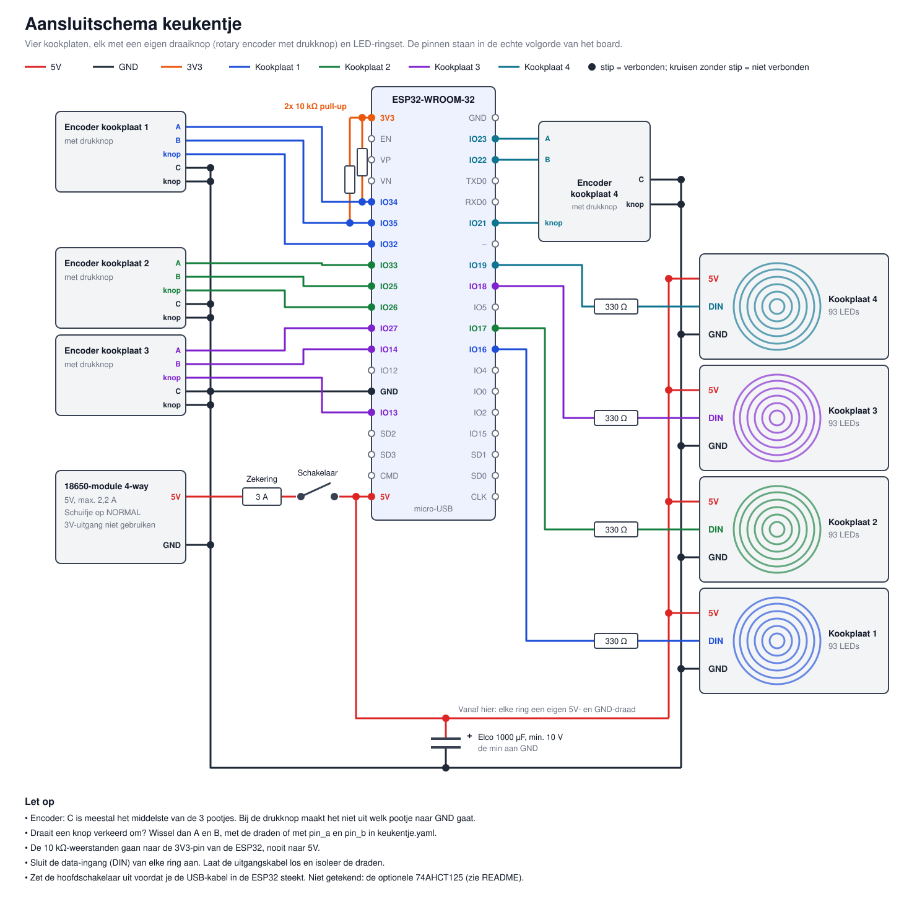

# esp32_speeldgoed-keuken
Speelgoed keuken met LED-Ring kookplaat, aangestuurd door ESP32

Vier kookplaten met elk zes WS2812B-ringen (93 LEDs) en een eigen potmeter. Hoe
verder de knop open staat, hoe meer ringen er branden. De ringen lichten één voor
één langzaam op, van binnen naar buiten. Draai je de knop terug, dan gaan ze
weer één voor één uit. Een plaat die 30 minuten niet is aangeraakt gaat vanzelf
uit. De firmware is ESPHome en werkt ook zonder wifi.

## Onderdelen

| Aantal | Onderdeel | Waarvoor |
|---|---|---|
| 1 | ESP32-WROOM-32 devboard (38 pins) | De besturing |
| 4 | LED-ringsets WS2812B, 93 LEDs | De kookplaten |
| 4 | Potmeter 10 kΩ **lineair** (B10K) | De knoppen |
| 4 | Weerstand 330 Ω | In elke datalijn |
| 1 | Elco 1000 µF (470 µF of meer kan ook), minstens 10 V | Vangt stroompieken op; aangeraden |
| 0 of 4 | Condensator 100 nF | Alleen als een ring trilt terwijl je de knop niet aanraakt (zie Waar je op moet letten) |
| 1 | 18650-module 4-way met 4 gelijke cellen | Voedt alles |
| 1 | Aan/uit-schakelaar, minstens 3 A | Hoofdschakelaar, echt nodig (zie Voeding) |
| 1 | Zekering 3 A met houder | Beveiligt de bedrading |
| 0 of 1 | 74AHCT125 of 74HCT125 (DIP-14) | Alleen als de LEDs haperen (zie Datasignaal) |

## Aansluiten



```
 Module 5V ──[zekering 3A]──[schakelaar]──┬─────────► 5V van ring 1, 2, 3 en 4 (elk een eigen draad)
                                          ├─────────► 5V-pin van de ESP32
                                          └─[1000µF]─┐ (let op: min van de elco aan GND)
 Module GND ──────────────────────────────┬──────────┘
                                          ├─────────► GND van ring 1, 2, 3 en 4
                                          └─────────► GND-pin van de ESP32

 ESP32 GPIO ──[330Ω]──► DIN van de ring

 ESP32 3V3 ──► potmeter buitenpoot 1
 ESP32 GND ──► potmeter buitenpoot 2
 ESP32 GPIO ◄── potmeter middenpoot
```

### Per kookplaat

| Kookplaat | Potmeter middenpoot | LED-data, via 330 Ω naar DIN |
|---|---|---|
| 1 | GPIO32 (IO32) | GPIO16 (IO16) |
| 2 | GPIO33 (IO33) | GPIO17 (IO17) |
| 3 | GPIO34 (IO34) | GPIO18 (IO18) |
| 4 | GPIO35 (IO35) | GPIO19 (IO19) |

### Waar je op moet letten

- **Gebruik de 3V-uitgang van de module niet.** De ESP32 krijgt 5V op de 5V-pin, en de potmeters krijgen hun spanning van de 3V3-pin van de ESP32.
- **Voed de LEDs niet via de ESP32.** De 5V-stroom gaat rechtstreeks van de module naar de ringen.
- **Alle GND's moeten verbonden zijn**: module, ESP32, ringen en potmeters.
- **Potmeters alleen op 3V3 van de ESP32, nooit op 5V.** Meer dan 3,3 V kan de ESP32 beschadigen.
- **Ring-ingang:** sluit de kabel aan die op de print bij de data-ingang (DIN) zit. Laat de uitgangskabel los en isoleer de draden. Controleer de opdruk op de print, want de draadkleuren verschillen per partij.
- **Draaddikte:** 0,75 mm² vanaf de module, minstens 0,5 mm² naar elke ring. Soldeer op de 5V/GND-pads; dat is steviger dan via de USB-A-poort.
- **Datadraden:** zo kort mogelijk, liefst onder de 50 cm, en het liefst naast een GND-draad.
- **Draait een knop de verkeerde kant op?** Wissel dan de twee buitenpoten om.
- **Trilt een ring terwijl je de knop niet aanraakt?** Zet dan 100 nF tussen de middenpoot van die potmeter en GND.
- **Elco:** plaats hem zo dicht mogelijk bij het punt waar de 5V-draden naar de ringen splitsen. Laat je hem weg, doe dan de starttest extra goed. Valt de ESP32 of de module uit, of knipperen er LEDs, dan moet hij er alsnog in.
- **USB en module:** zet de hoofdschakelaar uit voordat je de USB-kabel insteekt.

### Waarom deze pins

- **Potmeters op GPIO32-35:** dit zijn ADC1-pins. ADC2 (o.a. GPIO25-27) werkt niet zodra wifi aan staat.
- **Data op GPIO16-19:** dit zijn geen strapping-pins (0, 2, 5, 12, 15), dus ze storen het opstarten niet.
- **Vier losse datalijnen:** als één plaat stukgaat, blijven de andere drie werken.

## Datasignaal: is een 74AHCT125 nodig?

WS2812B op 5 V ziet een signaal officieel pas boven 3,5 V (0,7 x 5 V) als "hoog", en de ESP32
geeft maximaal 3,3 V. Dat is buiten de specificatie, maar werkt in de praktijk vaak wel.
De 74AHCT125 lost dit op: hij herkent 3,3 V als "hoog" en geeft 5 V af, en met vier kanalen past
hij precies op vier ringen.

**Begin zonder.** De chip zit niet in de epoxy, dus je kunt hem later alsnog toevoegen.

Test elke ring vóór het gieten met een volle accu en de echte kabellengte. Twijfel je door flikkeren,
verkeerde kleuren of LEDs die willekeurig aangaan, voeg dan de chip toe. Een 74HCT125 is even goed; een
74HC125 (zonder T) werkt niet, en de losse 4-kanaals modules met BSS138 zijn vaak te traag voor dit signaal.

Aansluiting van de chip: pin 14 aan 5V, pin 7 aan GND, pin 1, 4, 10 en 13 aan GND, en 100 nF tussen
pin 14 en 7. De GPIO gaat naar de ingang, de uitgang gaat via 330 Ω naar DIN:

| Kookplaat | Ingang | Uitgang |
|---|---|---|
| 1 | pin 2 | pin 3 |
| 2 | pin 5 | pin 6 |
| 3 | pin 9 | pin 8 |
| 4 | pin 12 | pin 11 |

## Voeding: de 18650-module

De module (4-way) levert 5 V bij **2,2 A**. De firmware verdeelt daarom de stroom: alle platen
samen blijven onder 1,7 A voor de LEDs, en de helderheid wordt daarop berekend.

| Opstelling | LEDs | Verbruik LEDs uit (incl. ESP32) | Helderheid | Leeg bij alles uit | Leeg bij alles vol aan |
|---|---|---|---|---|---|
| 4 x 93 | 372 | ca. 0,5 A | ca. 14% | ca. 15 uur | ca. 3,5 uur |

Dit zijn schattingen, uitgaande van 4 cellen van 3000 mAh en 85% rendement.

- **Hoofdschakelaar:** WS2812B-LEDs verbruiken ook stroom als ze uit staan. De automatische uitschakeling van de module werkt alleen onder 30 mA, en de ESP32 alleen zit daar al boven. Zonder schakelaar loopt de accu dus ook leeg als alle knoppen dicht staan.
- **Schuifje op de module:** zet het op NORMAL. HOLD laat een weerstand warm worden en is hier niet nodig.

**Feller nodig?** Sluit een 5V-adapter van 5 A aan, vervang de zekering door een van 5 A en zet
`LED_BUDGET_MA` op 3300; dat geeft 30%, de bovengrens van de firmware. Twee modules parallel schakelen
mag niet; wel kun je elke module een eigen groep ringen geven, met gezamenlijke GND.

### Veilig omgaan met de accu's

Dit zit in speelgoed voor een kind, dus:

- **Gelijke cellen:** de cellen staan parallel zonder balancering. Gebruik vier cellen van hetzelfde merk en type, even oud en even vol. Een volle en een lege cel samen geeft een grote stroom tussen de cellen.
- **Polariteit:** een cel verkeerd om plaatsen brandt de module door (staat ook in de specs).
- **Afsluiten:** zet module en cellen in een dicht, ventilerend vak dat alleen met een schroevendraaier opengaat. Giet ze nooit in epoxy en dek ze niet af met isolatie.
- **Opladen:** gebruik een gewone 5V-lader, geen snellader (kopers melden dat de laadchip daarvan doorbrandt), en doe het alleen onder toezicht. De module laadt met 0,6-0,8 A, dus vier lege cellen van 3000 mAh duren 15 tot 20 uur.
- **Zekering:** zet die direct achter de 5V-uitgang, voor het geval van kortsluiting in de bedrading.

## Firmware installeren

Nieuwere Python-versies werken nog niet met ESPHome (3.15 faalt, 3.13 werkt), dus kies expliciet 3.13:

```sh
pipx install --python python3.13 esphome
cd esphome
cp secrets.yaml.example secrets.yaml   # en vul secrets.yaml in
openssl rand -base64 32                # plak dit als api_key in secrets.yaml
esphome run keukentje.yaml             # eerste keer: kies de USB-poort
```

Daarna kan elke update via wifi met hetzelfde commando; kies dan `keukentje.local`.
Wordt het board niet herkend, installeer dan de driver voor de USB-chip (CP2102 of CH340).

## Aanpassen

| Wat | Waar |
|---|---|
| Aantal LEDs per kookplaat | `leds_per_hob` in [keukentje.yaml](esphome/keukentje.yaml) én `RING_SIZES` in [hob_effect.h](esphome/hob_effect.h) |
| Tempo van de ringen, automatisch uit, stroomgrens | Bovenaan [hob_effect.h](esphome/hob_effect.h) |
| Kleur | `GREEN_RATIO` in [hob_effect.h](esphome/hob_effect.h) |
| Begint de plaat aan de buitenkant? | Zet `DATA_ENTERS_AT_CENTER` op `true` in [hob_effect.h](esphome/hob_effect.h) |

## Vóór je de epoxy giet

Epoxy kun je niet meer openmaken, dus test eerst alles:

1. **Ringvolgorde.** Draai een knop een klein stukje open: de binnenste LED hoort aan te gaan. Begint hij buiten, of lopen de ringen door elkaar, zet dan `DATA_ENTERS_AT_CENTER` om. Welke kant de data binnenkomt kon ik niet uit de specs halen.
2. **Alles aangesloten testen.** Controleer alle vier de platen en het volledige bereik van de knop, ook met een bijna lege accu.
3. **Starttest.** Zet de hoofdschakelaar een paar keer uit en aan, met alle knoppen open. De module mag niet uitvallen.
4. **Warmtetest.** Laat alle platen minstens 30 minuten op vol staan, afgedekt zoals ze straks zitten. Voel of ze warm worden en meet het liefst: blijf ruim onder de 50 °C op het oppervlak.
5. **Epoxy-proef.** Giet eerst één LED of restje ring in. Dikke lagen kunnen heet worden tijdens het uitharden, dus giet in dunne lagen en volg de instructies van de epoxy.
6. **Aansluitingen buiten de epoxy.** Houd stekkers bereikbaar, zodat je een plaat kunt loskoppelen.
7. **Trekontlasting.** Zet de kabels vast, zodat er niet aan de soldeerpunten getrokken kan worden.
